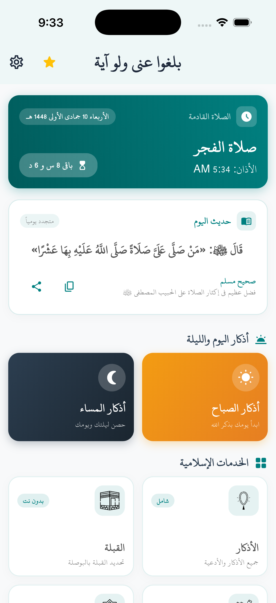
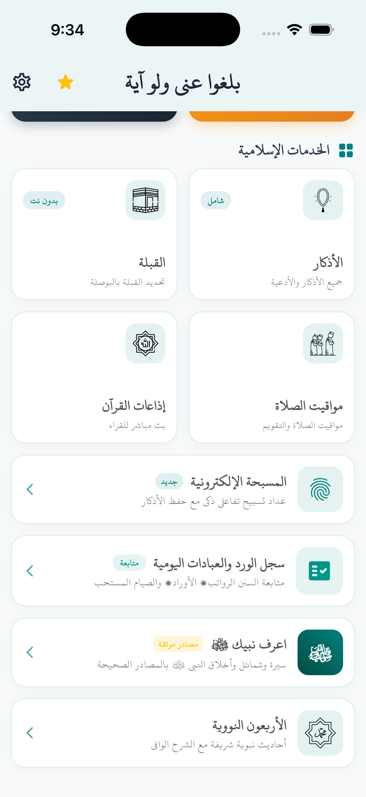
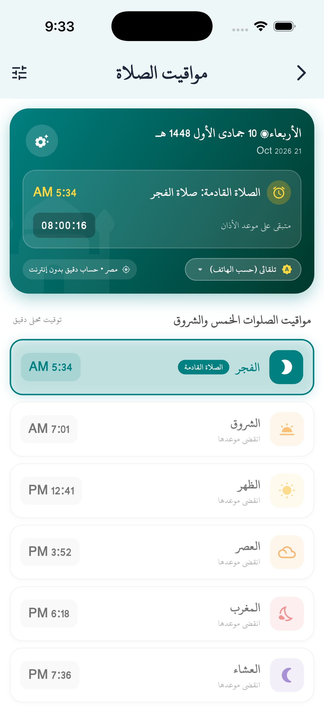
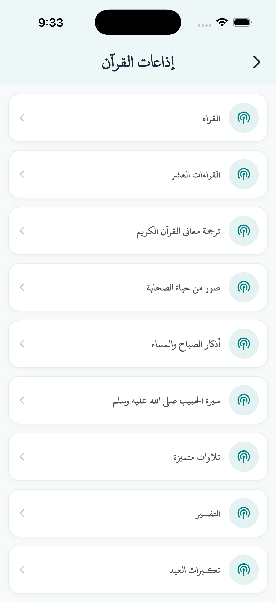
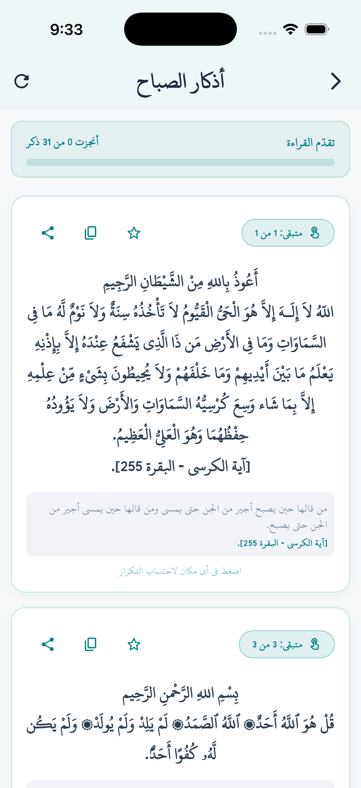
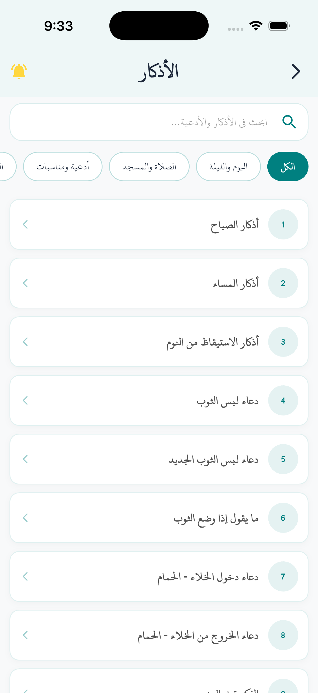
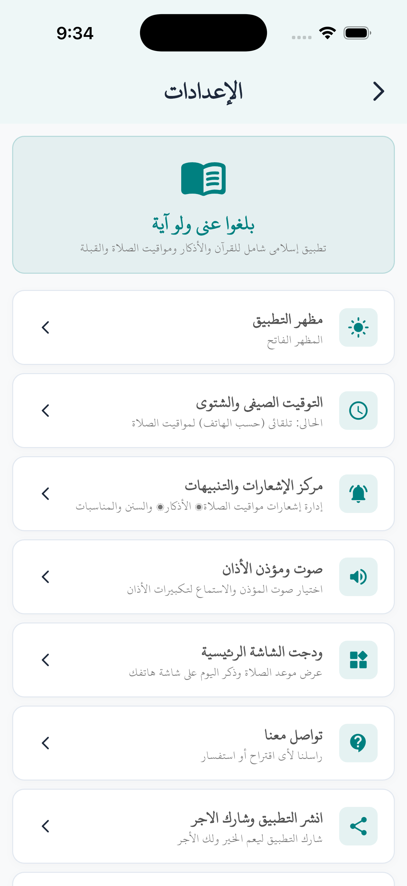
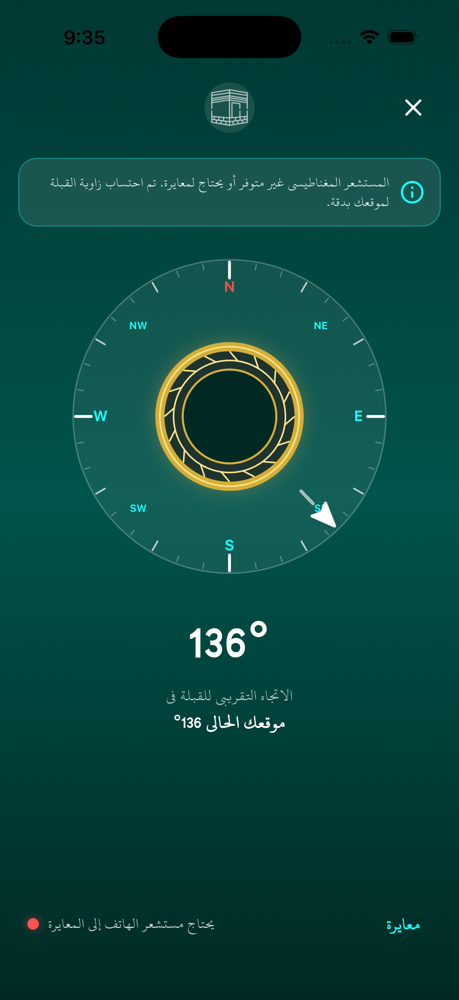

<div align="center">


# تطبيق بَلِّغُوا عَنِّي (Balgho Convey)
### تطبيق إسلامي شامل ومجاني، بدون إعلانات، يعمل في معظم ميزاته بدون إنترنت (Offline-First)

[](https://flutter.dev)
[](https://dart.dev)
[](https://riverpod.dev)
[](LICENSE)
[](https://play.google.com/store/apps/details?id=com.convey.ayah.mohamed.ayad)

<p align="center">
  <a href="https://play.google.com/store/apps/details?id=com.convey.ayah.mohamed.ayad">
    
  </a>
</p>

> **قال رسول الله صلى الله عليه وسلم:**  
> «بَلِّغُوا عَنِّي ولو آيَةً، وَحَدِّثُوا عن بَنِي إِسْرَائِيلَ وَلَا حَرَجَ، وَمَن كَذَبَ عَلَيَّ مُتَعَمِّدًا، فَلْيَتَبَوَّأْ مَقْعَدَهُ مِنَ النَّارِ»  
> *(صحيح البخاري: 3461)*

</div>

---

## 📱 معرض الصور (Screenshots)

<div align="center">
  
  
  
</div>
<br/>
<div align="center">
  
  
  
</div>
<br/>
<div align="center">
  
  
  
</div>

---

## ✨ المميزات الرئيسية (Key Features)

- 📖 **القرآن الكريم كاملًا**: قراءة المصحف الشريف بالرسم العثماني الموثوق مع فهرس السور والبحث والآيات المفضلة.
- 🕌 **مواقيت الصلاة والأذان (Offline)**: حساب فلكي دقيق بالكامل بدون إنترنت، مع عد تنازلي حي، واختيار أصوات الأذان وتخزينها محلياً على الجهاز.
- 🧭 **بوصلة اتجاه القبلة**: تحديد دقيق وسلس لاتجاه الكعبة المشرفة وفق إحداثيات الموقع بتصميم مريح ومتناسق.
- 📿 **أذكار المسلم (حصن المسلم)**: أكثر من 130 باباً للأذكار والأدعية النبوية مع عداد إلكتروني وميزة حفظ التصنيفات في المفضلة.
- 📜 **الأربعون النووية**: الأحاديث النبوية الأربعون كاملة مع شرح مبسط وميسر لكل حديث وميزة الاستماع الصوتي.
- 📻 **إذاعات القرآن الكريم**: بث مباشر لعشرات الإذاعات الإسلامية وقراء العالم الإسلامي مع مؤشر موجات صوتية تفاعلي (Equalizer Visualizer).
- 📱 **ويدجت الشاشة الرئيسية (Native Android AppWidgets)**: ويدجت لمواقيت الصلاة القادمة وويدجت لذكر اليوم تظهر مباشرة في شاشة أندرويد الرئيسية وتُحدث تلقائياً.
- 🌟 **ذكر اليوم والمفضلة الموحدة**: عرض ذكر أو حديث يومي متجدد مع نظام مفضلة موحد يتيح حفظ أي ذكر أو سورة أو إذاعة.
- 📿 **السبحة الإلكترونية الذكية**: عداد تسبيح رقمي مع ميزة الاهتزاز اللمسي (Haptic Feedback) ونبضة تنبيهية عند بلوغ الهدف المحدد.
- 🔔 **تنبيهات وإشعارات متقدمة**: إشعارات للأذكار والصلوات تدعم أنظمة أندرويد الحديثة (Android 13+ و 14+) مع قنوات إشعارات بأولوية قصوى.
- 🌓 **الوضع الليلي والنهاري (Dark / Light Theme)**: دعم كامل للثيم الداكن عالي التباين لحماية العين أثناء القراءة ليلاً.

---

## 🛠️ كيف بُني التطبيق ومصادر البيانات (Architecture & Data Sources)

تم بناء التطبيق باتباع مبدأ **Offline-First** (العمل بدون إنترنت) واعتماد معمارية برمجية نقية ومنظمة:

### 1. معمارية المشروع (Clean Feature-First Architecture)
- **إدارة الحالة**: يعتمد التطبيق بالكامل على `hooks_riverpod` لتوفير حالة تفاعلية سريعة، مستقرة، وقابلة للاختبار.
- **فصل الطبقات**: تدفق بيانات واضح وصارم:
  $$\text{UI (Widgets/Screens)} \longrightarrow \text{Providers (State Orchestration)} \longrightarrow \text{Repositories} \longrightarrow \text{Data Sources}$$

### 2. مصادر البيانات والمحتوى (Data Sources)
- **مواقيت الصلاة**: تُحسب فلكياً داخل الجهاز محلياً بالاعتماد على خوارزميات حزمة `adhan` الفلكية المعتمدة (وفق معايير الهيئة المصرية العامة للمساحة، أم القرى، وغيرها)، ولا يعتمد التطبيق على أي سيرفر خارجي لحساب المواقيت، مما يضمن دقة وسرعة فورية بدون اتصال.
- **ملفات الأذان الصوتية**: يتم تخزين أصوات الأذان في الذاكرة المحلية للجهاز (`azan_sounds/`) عبر خدمة `AzanAudioCacheService` بمجرد تحميلها لتعمل دون إنترنت مستقبلاً.
- **القرآن الكريم والأذكار والأحاديث**:
  - نصوص القرآن الكريم بالرسم العثماني مدمجة داخل التطبيق من خلال ملفات محلية مدققة.
  - الأحاديث النبوية (الأربعون النووية) وشروحاتها مأخوذة من مصادر موثقة ومدمجة محلياً داخل `assets/json/nawawi.json`.
  - الأذكار والأدعية مأخوذة من كتاب *حصن المسلم* ومصادر الأذكار الموثقة ومدمجة داخل `assets/json/`.
- **إذاعات القرآن الكريم**: قائمة محطات البث الإذاعي متصلة بمصادر شبكة [MP3Quran](https://www.mp3quran.net/) الرسمية والموثوقة.
- **ويدجت الشاشة الرئيسية (AppWidgets)**: مبنية برمجياً بلغة **Kotlin** لنظام Android كـ Native AppWidgets وتتصل مع Flutter عبر `MethodChannel` لتحديث بيانات الصلاة والذكر تلقائياً.

---

## 💻 بيئة التطوير والتقنيات (Tech Stack)

| التقنية / المكتبة | الغرض والاستخدام |
| :--- | :--- |
| **Flutter & Dart** | إطار العمل ولغة البرمجة الأساسية عبر المنصات |
| **hooks_riverpod** | إدارة حالة التطبيق ودورة الحياة وحقن الاعتماديات |
| **adhan** | الحسابات الفلكية الرياضية الدقيقة لمواقيت الصلاة محلياً |
| **audioplayers** | تشغيل البث الإذاعي وملفات الأذان الصوتية |
| **flutter_local_notifications** | جدولة وإرسال التنبيهات مع دعم أندرويد الحديث |
| **dio** & **path_provider** | تحميل وتخزين أصوات الأذان محلياً (Caching) |
| **shared_preferences** | حفظ تفضيلات المستخدم والمفضلة والإعدادات محلياً |
| **Kotlin RemoteViews** | ويدجت الشاشة الرئيسية الأصلية لنظام أندرويد |

---

## 🚀 تشغيل المشروع محلياً (Getting Started)

1. **استنساخ المستودع (Clone the repository)**:
   ```bash
   git clone https://github.com/Muhammed-Ayad/Balgho-Convey-App.git
   cd Balgho-Convey-App
   ```

2. **تثبيت الحزم والاعتماديات (Install dependencies)**:
   ```bash
   flutter pub get
   ```

3. **تشغيل الفحص والتحليل (Analyze & Test)**:
   ```bash
   flutter analyze
   flutter test
   ```

4. **تشغيل التطبيق (Run the application)**:
   ```bash
   flutter run
   ```

---

## 📬 تواصل معنا (Contact & Support)

لأي استفسارات، اقتراحات، أو للإبلاغ عن أي خطأ، يسعدنا تواصلكم عبر البريد الإلكتروني:  
📧 **mohamedayaddev@gmail.com**

---

## 📄 الترخيص (License)

هذا المشروع مرخص تحت رخصة **MIT License** — طالع ملف [LICENSE](LICENSE) لمزيد من التفاصيل.
